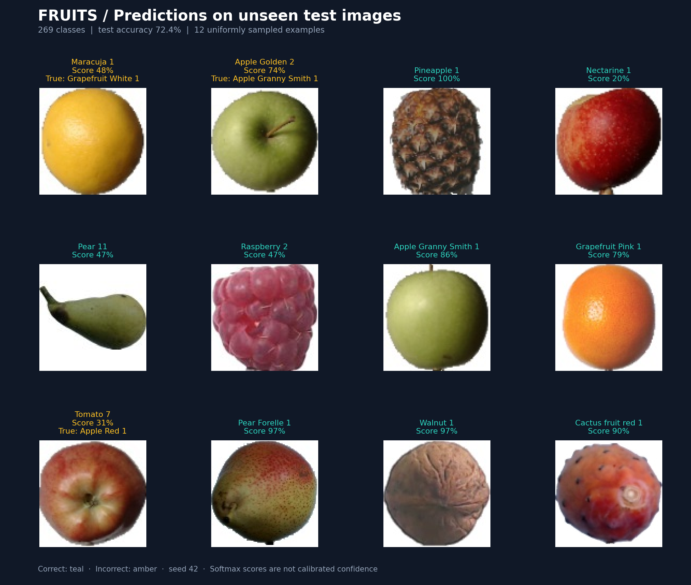
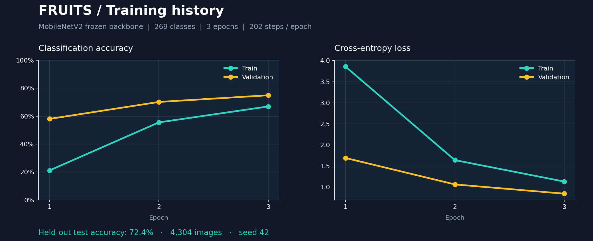
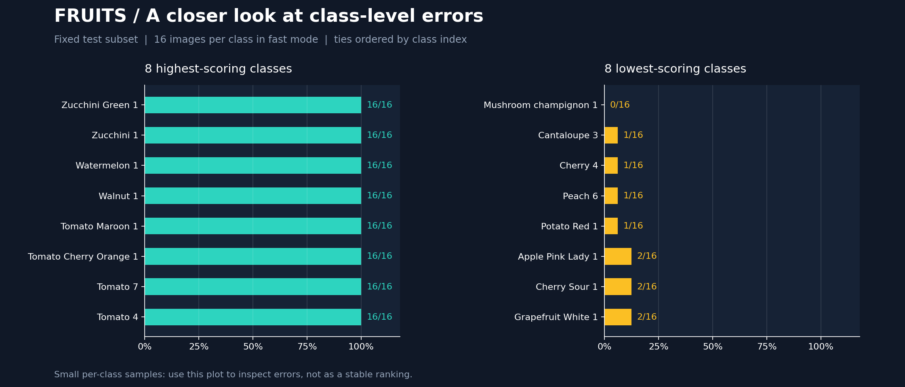
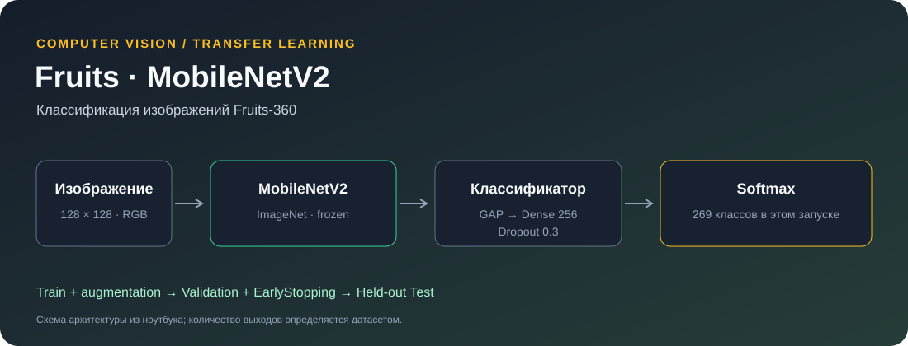

# 🍎 Fruits — Image Classification

Классификация изображений фруктов и овощей из **Fruits-360** с помощью **MobileNetV2**. Проект показывает полный цикл transfer learning: подготовку выборок, аугментации, короткое обучение, оценку на отложенных данных и загрузку сохранённой модели для предсказаний.

[](https://www.python.org/)
[](https://www.tensorflow.org/)
[](https://www.kaggle.com/code/mrmoderator/fruits)

---

## 💡 Пример реализации



**12 случайных изображений из test.** Зелёный заголовок означает правильный класс, оранжевый — ошибку с указанием настоящего класса. Примеры выбраны с `seed=42`, без отбора по правильности; проценты — softmax-score модели.

<table>
  <tr>
    <td width="50%"></td>
    <td width="50%"></td>
  </tr>
  <tr>
    <td align="center"><b>История обучения</b></td>
    <td align="center"><b>Разбор ошибок по классам</b></td>
  </tr>
</table>

Все графики получены при выполнении [fruits.ipynb](fruits.ipynb). Подробности запуска и численные результаты — ниже. Изображения в галерее: Fruits-360, © Mihai Oltean, [CC BY-SA 4.0](https://creativecommons.org/licenses/by-sa/4.0/); компоновка и подписи предсказаний добавлены в этом проекте, галерея распространяется на тех же условиях.

---

## 🚀 Ключевые возможности

- **Transfer learning** — замороженная MobileNetV2 и обучаемая классификационная часть.
- **Быстрый режим** — до 3 эпох на подвыборке из 24 обучающих изображений каждого класса (202 шага на эпоху в опубликованном запуске).
- **Раздельные train / validation / test** — validation выделяется из `Training`, test берётся из отдельной папки `Test`.
- **Единая предобработка** — `preprocess_input` используется при обучении, оценке и предсказании.
- **Сохранение результата** — модель `.keras`, порядок классов, метрики и история обучения в JSON.
- **Визуальный анализ** — кривые обучения, случайные примеры и сравнение восьми лучших и восьми худших классов по test accuracy.

---

## 🛠 Технологический стек

- **Python 3.12**
- **TensorFlow / Keras** — нейросеть и transfer learning
- **NumPy, pandas, SciPy** — подготовка выборок и аугментации
- **Matplotlib** — визуализация результатов
- **Pillow** — работа с изображениями
- **Jupyter Notebook / Kaggle** — обучение и анализ

---

## 📈 Этапы реализации

### 1. Данные и разбиение

Источник — [Fruits-360 на Kaggle](https://www.kaggle.com/datasets/moltean/fruits), автор **Mihai Oltean**. [Официальный репозиторий данных](https://github.com/fruits-360/fruits-360-100x100) и [лицензия датасета](https://github.com/fruits-360/fruits-360-100x100/blob/main/LICENSE). Используются каталоги `Training` и `Test` из набора `fruits-360_100x100/fruits-360`.

В быстром режиме из каждого класса случайно выбираются **24 train**, **8 validation** и **16 test** изображений. Validation не пересекается с train; test не используется в `model.fit`. Разбиение фиксируется с `seed=42`, порядок классов — сортировкой имён в `Training`. Названия папок `Training` и `Test` сопоставляются без учёта регистра: в исходном наборе встречаются отличия вроде `BlackBerry 4` / `Blackberry 4`. Неоднозначные совпадения вызывают явную ошибку.

Только train получает аугментации: повороты до 20°, сдвиги по ширине и высоте до 20% и горизонтальное отражение. Изображения приводятся к **128 × 128 RGB**. [Предобработка MobileNetV2](https://www.tensorflow.org/api_docs/python/tf/keras/applications/mobilenet_v2/preprocess_input) масштабирует пиксели в диапазон `[-1, 1]`.

### 2. Архитектура



Предобученная на ImageNet MobileNetV2 используется без исходного классификатора. Её веса заморожены. Обучается блок `GlobalAveragePooling2D → Dense(256, ReLU) → Dropout(0.3) → Dense(N, Softmax)`, где `N` определяется по каталогам классов.

Оптимизатор — **Adam**, функция потерь — **categorical cross-entropy**. `EarlyStopping` следит за `val_loss` и восстанавливает лучшие веса.

### 3. Результат короткого запуска

Запуск выполнен в Kaggle на CPU, **15 октября 2026**, TensorFlow **2.19.0**, Keras **3.10.0**. Исходные 15 эпох и 500 шагов сокращены до **3 эпох × 202 шага** на сбалансированной подвыборке.

| Параметр / метрика | Значение |
| --- | ---: |
| Классов | 269 |
| Train / validation / test | 6,456 / 2,152 / 4,304 |
| Эпох × шагов | 3 × 202 |
| Batch size | 32 |
| Test accuracy | **72.44%** |
| Test cross-entropy loss | 0.9599 |
| Seed | 42 |

Результаты сохранены в [metrics.json](results/metrics.json), [history.json](results/history.json) и [таблице по классам](results/class_accuracy.csv). В ноутбуке сохранены вывод обучения и реальные графики. Зависимости локального окружения проверены на TensorFlow 2.20.0 и Keras 3.10.0; численные результаты выше получены в Kaggle на 2.19.0. Между версиями и устройствами возможны различия.

<details>
<summary>Как интерпретировать результат</summary>

Это короткий учебный эксперимент на фиксированной подвыборке Fruits-360. Accuracy измеряет долю верно определённых классов на этой подвыборке. Для каждого класса в test используется небольшое число изображений, поэтому график классов служит разбором ошибок, а не устойчивым рейтингом качества.

Изображения Fruits-360 сняты в контролируемых условиях. Разбиение по файлам не гарантирует независимость по физическому объекту или серии съёмки; результат не показывает качество на произвольных фотографиях с телефона. Softmax-score не является калиброванной вероятностью правильного ответа.

Следующие шаги: больше обучающих изображений, fine-tuning верхних слоёв, оценка по независимым сериям съёмки и внешним фотографиям.

</details>

---

## 🖥 Использование

### Установка

```bash
git clone https://github.com/golovanov-andrei/Fruits.git
cd Fruits
python -m venv .venv
```

```powershell
# Windows PowerShell
.\.venv\Scripts\Activate.ps1
```

```bash
# macOS / Linux
source .venv/bin/activate
```

```bash
python -m pip install -r requirements.txt
jupyter notebook fruits.ipynb
```

### Подготовка данных и обучение

Скачайте [Fruits-360](https://www.kaggle.com/datasets/moltean/fruits) и разместите каталоги так:

```text
data/fruits-360/
├── Training/
│   ├── Apple .../
│   └── .../
└── Test/
    ├── Apple .../
    └── .../
```

Либо задайте `FRUITS_DATA_DIR` — путь к папке, внутри которой находятся `Training` и `Test`, — перед запуском Jupyter. В Kaggle стандартные пути определяются автоматически.

Выполните ячейки сверху вниз. Для первой загрузки весов ImageNet нужен интернет. Для офлайн-запуска можно указать `MOBILENET_WEIGHTS`: путь к совместимым весам MobileNetV2 `include_top=False`.

По умолчанию включён `FAST_MODE=True`. Для обучения на полном наборе переключите его на `False`: тогда validation составит 20% исходной папки `Training`, а каждая эпоха пройдёт всю обучающую выборку. Число эпох задаётся отдельно через `EPOCHS`.

### Предсказание

После обучения ячейка «Загрузка и предсказание» загружает модель и соответствующий ей JSON классов:

```python
label, score, img = predict_fruit("path/to/fruit.jpg")
print(label, f"{score:.1%}")
```

Модель и данные не включены в Git. При запуске ноутбука в `artifacts/` создаются:

```text
fruits_mobilenet_v2.keras   # Модель с обученными весами
class_indices.json         # Соответствие названий классов индексам
metrics.json               # Настройки запуска и test-метрики
history.json               # Train / validation по эпохам
training_history.png       # Кривые обучения
predictions.png            # Примеры предсказаний
class_accuracy.png         # Разбор ошибок по классам
```

---

## 📂 Структура проекта

```text
Fruits/
├── fruits.ipynb             # Подготовка, обучение, оценка и предсказания
├── requirements.txt         # Зависимости локального окружения
├── results/                 # Метрики и история опубликованного запуска
├── screens/                 # Реальные графики и схема модели
├── .gitignore               # Исключение данных, окружения и весов
└── README.md
```

Исходный кейс: [ноутбук автора на Kaggle](https://www.kaggle.com/code/mrmoderator/fruits).

---

## 👤 Автор

**Андрей Голованов**
[GitHub](https://github.com/golovanov-andrei) · [Telegram](https://t.me/andr3ikaG)
